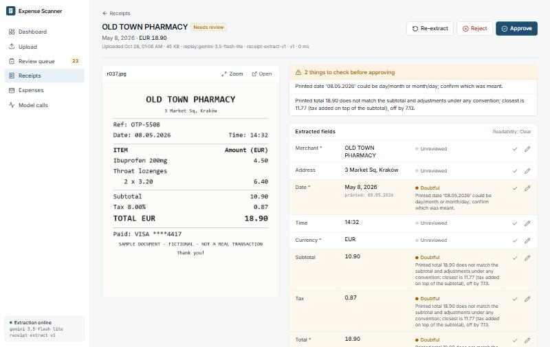
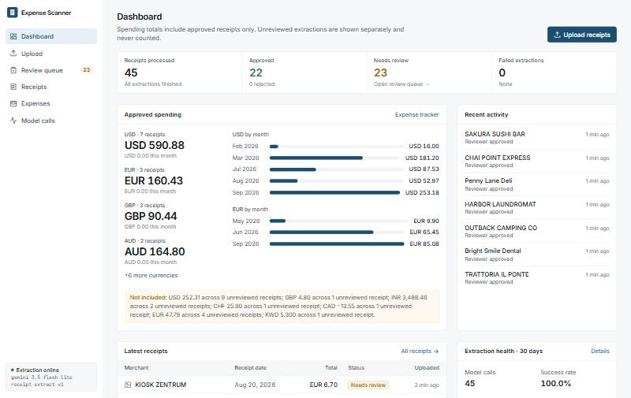
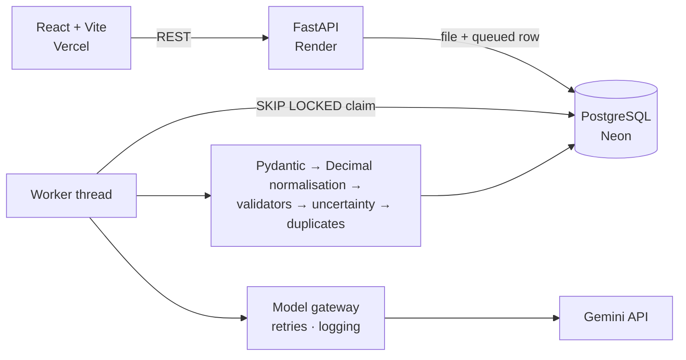

# AI Expense Scanner

Receipts and invoices in, a verified expense tracker out. Google Gemini reads a photo or PDF into a strict
schema; deterministic rules check the arithmetic, dates and formats; every field the system doubts is
highlighted with the reason, and a person fixes or confirms it in one action before anything reaches the books.

> **Schema-valid is not correct.** Structured output guarantees the shape of the JSON, not the truth of the
> numbers. This project measures how often the model is wrong and how often the rules catch it.

https://github.com/user-attachments/assets/f3f0a3f4-3272-4b0f-8416-ccfafc7c9118

▶ Video not playing (for example in the GitHub mobile app)? [Watch the 70-second demo](https://github.com/user-attachments/assets/f3f0a3f4-3272-4b0f-8416-ccfafc7c9118)

**Live demo:** [ai-expense-tracker-eta-sandy.vercel.app](https://ai-expense-tracker-eta-sandy.vercel.app) (access code required; see [DEPLOYMENT.md](DEPLOYMENT.md)). **Evaluation:** 99.7% (311/312) key-field accuracy and validators that caught 44/44 injected total misreads — on a synthetic 56-document set with `gemini-3.5-flash-lite` ([report](evaluation/results/published/report.md)).

| Measured on 56 synthetic documents · `gemini-3.5-flash-lite` · prompt `receipt-extract-v1` | Result |
|---|---|
| Schema-valid responses | 100.0% (53/53) |
| Key-field accuracy (merchant, date, currency, subtotal, tax, total) | 99.7% (311/312) |
| Exact-match receipts (all key fields + every line item) | 98.1% (51/52) |
| Planted arithmetic errors caught / false alarms | 3/3 / 0 of 47 |
| Injected misreads flagged by the validators (perturbation test) | 228/315 overall; totals 100%, subtotals 100%, line totals 98%, tax 68%, wrong-but-plausible date/currency 0% |
| Review load (correct values flagged anyway) | 8.7% (27/311) |
| Latency p50 / p95 per receipt | 3.6 s / 5.0 s |

---

## What it does

* **Multimodal extraction** — JPEG, PNG, WebP and multi-page PDF; EXIF rotation, resizing and page splitting before a
  single Gemini call with a JSON schema (`google-genai` SDK, server-side only).
* **Two layers of schema validation** — Gemini structured output, then Pydantic. Invalid output is retried once and
  otherwise kept for debugging but never saved as data.
* **Deterministic financial checks** with `Decimal`: qty × unit price, lines vs subtotal, subtotal + tax + charges −
  discounts vs total under four accounting conventions (tax-inclusive VAT, discounts inside subtotal…), currency-aware
  rounding (USD 0.01, JPY 1, KWD 0.001), future/old/ambiguous dates, ISO 4217, refunds, implausible tax, GSTIN shape.
* **Measured doubt, not invented confidence** — each field is `extracted` (unreviewed), `uncertain`, `invalid`,
  `missing` or `verified`, with the rule that raised it.
* **Human review** — original document beside the fields, inline correction, one-tap confirm, line-item editor,
  approve (a written note is required to override a failing check), reject, re-extract. Every change is logged with the
  old and new values.
* **Duplicate detection** — exact files blocked by SHA-256; probable duplicates (same reference, or same merchant + date +
  amount) flagged with reasons and resolved by a person. Nothing is deleted automatically.
* **Expense tracker** — approved receipts only, by month and category, per currency, CSV export.
* **Model observability** — one gateway for every call; each attempt logged with trace ID, model, prompt version,
  tokens, latency, status and error category; bounded retries that tell transient errors from permanent ones.
* **Reproducible evaluation** — 56 labelled synthetic documents run through the production pipeline; per-field accuracy,
  exact-match receipts, line-item F1, reconciliation, flag recall vs review load, duplicate precision/recall, latency.

## Screenshots

| Review: a planted wrong total, flagged with the reason | Dashboard: approved spend separate from unreviewed |
|---|---|
|  |  |

## Architecture



| Layer | Choice |
|---|---|
| Frontend | React 19, Vite, TypeScript (strict), Tailwind CSS v4, TanStack Query, React Router |
| Backend | Python 3.12+, FastAPI, Pydantic v2, SQLAlchemy 2, Alembic |
| Database | PostgreSQL 16 (SQLite only for fast unit tests) |
| AI | Google Gemini via `google-genai` 2.x; default `gemini-3.5-flash-lite` (the evaluated model), configurable |
| Files | Pillow + pypdfium2 for validation and rasterising; originals stored in Postgres |
| Tests | pytest (unit, API, PostgreSQL, live-marked), Vitest + Testing Library |

### Extraction and validation pipeline

```
upload ─▶ size/type/decode checks ─▶ SHA-256 (exact duplicate?) ─▶ store original ─▶ 202 queued
worker ─▶ rotate/resize/split pages ─▶ Gemini + JSON schema ─▶ Pydantic ─▶ Decimal/ISO normalisation
       ─▶ financial checks ─▶ field statuses + review reasons ─▶ probable-duplicate lookup ─▶ needs_review
review ─▶ correct / confirm / edit lines (logged, re-validated) ─▶ approve ─▶ expenses table
```

Full walkthrough with file references: [WORKFLOW.md](WORKFLOW.md).

### Key decisions

* **The model transcribes, code calculates.** Amounts come back as printed decimal strings; the application parses them
  with `Decimal` and never asks the model to compute. A letter inside a number (`1O.5O`) is an error, not a silent `1.5`.
* **Nullable everything.** Without nullable fields a model fills empty slots with plausible values.
* **No confidence scores.** Doubt comes from rules, nulls, parse errors and optional two-pass disagreement, each with a reason.
* **Try every accounting convention, never "fix" the numbers.** A mismatch becomes an explained warning on the implicated fields.
* **Postgres as the queue and the file store.** One fewer service; `FOR UPDATE SKIP LOCKED` makes multiple workers safe;
  storage survives redeploys on hosts with ephemeral disks. Both are documented trade-offs.
* **Log every attempt in its own transaction.** A failed pipeline still keeps its call history. This is how the 20-requests/day
  free-tier quota was diagnosed (see below).

## Run it locally

Prerequisites: Docker, Python 3.11+, Node 20+, a Gemini API key from [Google AI Studio](https://aistudio.google.com/apikey).

```bash
docker compose up -d db
```

```bash
cd backend && python -m venv .venv && .venv/Scripts/pip install -r requirements-dev.txt
```

(`.venv/bin/pip` on macOS/Linux.) Then copy `backend/.env.example` to `backend/.env` and set `GEMINI_API_KEY`.

```bash
cd backend && .venv/Scripts/python -m alembic upgrade head && .venv/Scripts/python -m uvicorn app.main:app --reload --port 8000
```

```bash
cd frontend && npm install && npm run dev
```

Open <http://localhost:5173>. To see the app with data without spending quota, seed sample receipts from the recorded
evaluation outputs (no model calls; logged as provider `replay`):

```bash
cd backend && .venv/Scripts/python -m scripts.seed_demo --limit 12
```

### Environment

Backend variables are documented in [`backend/.env.example`](backend/.env.example) and [DEPLOYMENT.md §2](DEPLOYMENT.md#2-environment-variables).
The essentials: `DATABASE_URL`, `GEMINI_API_KEY`, `GEMINI_MODEL`, `FRONTEND_ORIGIN`, `APP_ENV`. The frontend needs only
`VITE_API_BASE_URL` in production. The Gemini key is never sent to the browser.

### Database migrations

```bash
cd backend && .venv/Scripts/python -m alembic upgrade head
```

The production container runs this on every start (`backend/start.sh`). `alembic check` reports no drift between models
and migrations.

## Tests

```bash
cd backend && .venv/Scripts/python -m pytest
```

```bash
cd frontend && npm test
```

Verified on 2026-10-28 (Windows, Python 3.14, Node 24, PostgreSQL 16 in Docker):

| Suite | Result |
|---|---|
| Backend unit + API (SQLite, scripted model) | 137 passed |
| PostgreSQL-only (migrations on empty DB, constraints, concurrent `SKIP LOCKED` claims, lease recovery) | 4 passed |
| Full backend suite on PostgreSQL | 137 passed |
| Live Gemini (`pytest -m live`, one real call) | 1 passed |
| Frontend (Vitest + Testing Library) | 11 passed; `tsc` strict and production build clean |
| `alembic check` (models vs migrations) | no drift |

Optional suites: `TEST_DATABASE_URL=postgresql+psycopg://… pytest -m postgres` (migrations, constraints, concurrent
claiming, lease recovery), `USE_TEST_POSTGRES=1 TEST_DATABASE_URL=… pytest` (whole suite on PostgreSQL),
`LIVE_GEMINI_API_KEY=… pytest -m live` (one real Gemini call). Unit tests never call Gemini; they use a scripted provider.

## Evaluation

```bash
python evaluation/generate_dataset.py
```

```bash
python evaluation/run_eval.py --publish
```

* **Dataset** — 50 fictional receipts + 3 exact duplicate files + 3 re-scans, rendered with ground truth
  ([details](evaluation/dataset/README.md)). 12 currencies, 7 date formats, tax-inclusive VAT, discounts, service charges,
  tips, blur/rotation/noise/crop/smudge, missing fields, ambiguous dates, planted wrong totals, a refund, a non-receipt,
  two-page PDFs, near-miss non-duplicates.
* **Harness** — runs the production code path (upload checks → preprocessing → gateway → normalisation → validators →
  uncertainty → duplicates). Raw outputs are saved; `--replay` re-scores them after a rule change with no model calls,
  and `--resume` continues an interrupted run.
* **Metrics** — schema validity and failure rate separate from correctness; exact per-field accuracy (money to the cent);
  line-item precision/recall/F1; exact-match receipts; reconciliation pass rate and planted-error catch rate; flag recall
  (wrong values flagged) vs review load (correct values flagged); receipt-level review detection; duplicate precision/recall;
  p50/p95 latency and token usage. The scorer is unit-tested with an oracle that must score 100%.

### Results

Published run: [`evaluation/results/published/report.md`](evaluation/results/published/report.md) (model outputs recorded
live in run `20261027T192259Z`, 53 Gemini calls) and
[`perturbation.md`](evaluation/results/published/perturbation.md).

| Field | Accuracy |
|---|---|
| merchant | 100.0% (52/52) |
| date | 98.1% (51/52) |
| currency | 100.0% (52/52) |
| subtotal | 100.0% (52/52) |
| tax | 100.0% (52/52) |
| total | 100.0% (52/52) |
| tip | 100.0% (52/52) |
| discount | 100.0% (52/52) |
| service_charge | 100.0% (52/52) |
| transaction_reference | 100.0% (52/52) |

* Line items: precision 100.0%, recall 100.0%; quantity and unit price
  correct on 96.6% (142/147) of matched lines.
* Receipt-level "needs review" detection: precision 96.0%, recall 100.0%.
* Duplicates: exact and probable both 100% precision and recall (3 exact files, 3 re-scans, 3 near-miss negatives — a small set).
* Mean tokens per receipt: 1571 input / 773 output. No cost is estimated.

**How to read these numbers.** The documents are synthetic printed receipts, so the model got almost everything right:
only one key-field value was wrong (the ambiguous `03/06/2026` read as `2026-03-03`, which is neither valid reading), and it was flagged. That makes the
live "flag recall" a sample of one, which is why the perturbation test exists: it injects realistic misreads into correct
outputs and shows that rules reliably catch anything that breaks arithmetic, miss tax misreads on tax-inclusive receipts,
and cannot catch a wrong-but-plausible date or currency at all. Most of the 8.7% review load is deliberate (ambiguous dates
the dataset rule says must be confirmed).

**What went wrong along the way, and was fixed:** the first run (`gemini-3.5-flash`) hit the key's free-tier quota of 20
requests/day per model; its outputs were lost because the runner only wrote at the end (it now appends as it goes and
supports `--resume`). Reviewing the first Flash-Lite results showed four labelling bugs in the dataset (a crop and a smudge
that did not hide what they claimed, a rounded unit price, an unknowable currency label); after fixing the generator, the
three changed images were re-extracted live and the rest re-scored from recorded outputs with `--replay`.

## Deployment

Render (Docker API + worker thread) + Neon (PostgreSQL) + Vercel (static frontend). Step-by-step instructions, smoke
tests and common errors: **[DEPLOYMENT.md](DEPLOYMENT.md)**. The production image has been built and verified locally
against a fresh database; it has not been deployed to a public URL.

## Security

The Gemini key is only in the server environment. Uploads are validated by content with size, pixel and page limits; there
is a per-IP upload limit and a daily model-call cap; an optional shared access code protects a public demo. Images are
re-encoded before leaving the server (EXIF/GPS stripped); logs contain metadata only; CSV export is formula-injection safe.
On Gemini's free tier Google may use inputs to improve its products, so do not process real personal receipts with a
free-tier key.

## Limitations

* No user accounts or per-user isolation; the access code is a demo gate, not authentication.
* The evaluation set is synthetic printed text: no handwriting, no real thermal-paper photos. Its numbers are not a
  real-world accuracy claim.
* Worker runs inside the web process; no object-storage backend; in-memory rate limiter; no cost tracking (tokens only).
* Date-order ambiguity is flagged, not resolved by locale; no OCR second opinion.

## Future improvements

Authentication and per-user data; a separate worker service and S3/R2 storage; exporting reviewer corrections as new
evaluation cases; a price table for per-receipt cost; locale-aware date parsing; an OCR cross-check; a model router that
escalates only flagged receipts to a stronger model; a small consented real-receipt test set.

## Documentation

* [WORKFLOW.md](WORKFLOW.md) — how the implemented system works, stage by stage
* [DEPLOYMENT.md](DEPLOYMENT.md) — production setup
* [INTERVIEW_QUESTIONS.md](INTERVIEW_QUESTIONS.md) — design questions and answers tied to the code
* [evaluation/results/published/report.md](evaluation/results/published/report.md) — latest published evaluation
