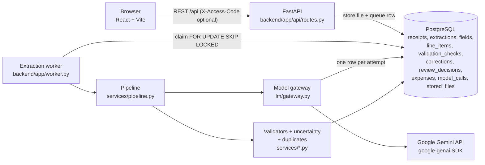
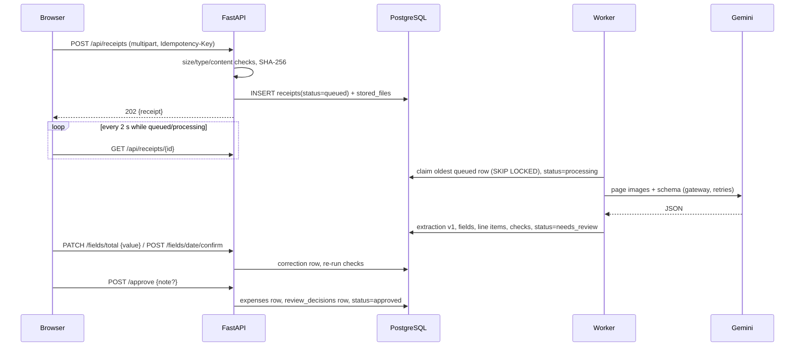
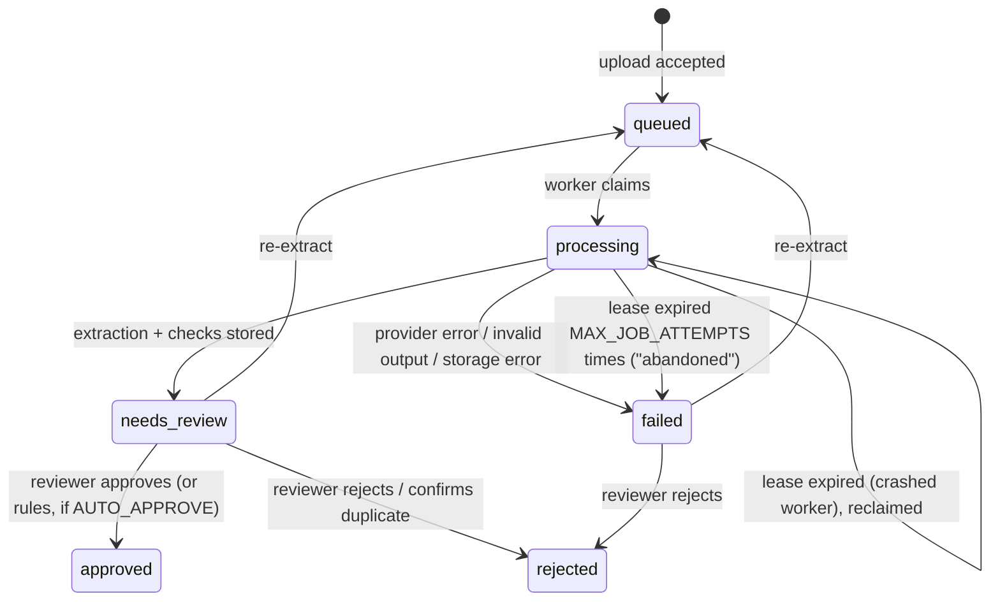
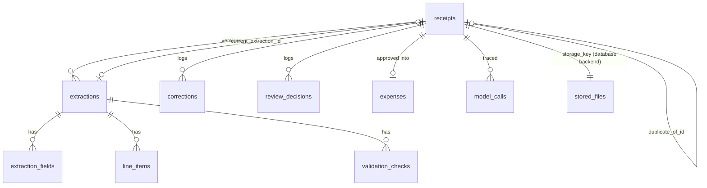

# How AI Expense Scanner works

This document describes the code as it is in this repository. File paths are relative to the repo root.

## 1. Overview

A user uploads a photo or PDF of a receipt. The backend stores it, queues it, and a worker sends the page
images to Google Gemini with a strict JSON schema. The reply is validated twice (by the API's structured
output and again by Pydantic), parsed with deterministic rules into exact decimals, and checked by
validators that know nothing about the model (arithmetic, dates, currency, formats). Every field gets a
status — `extracted`, `uncertain`, `invalid`, `missing`, later `verified` — with the reason stored. A
reviewer sees doubtful fields highlighted beside the original image, confirms or corrects them (each change
is logged), and approves the receipt into the expense tracker.

The rule from the roadmap the design follows: **schema-valid is not correct.** The JSON shape is
guaranteed by the API; the numbers are not, so nothing is trusted until rules and, where needed, a person
have checked it.

## 2. Architecture



Layers and where they live:

| Concern | Module |
|---|---|
| HTTP routes (thin) | `backend/app/api/routes.py`, DTOs in `backend/app/api/schemas.py`, errors in `api/errors.py` |
| App factory, CORS, access code, request logging | `backend/app/main.py`, `backend/app/logging_config.py` |
| Config (env vars) | `backend/app/config.py` |
| ORM models / migrations | `backend/app/models.py`, `backend/migrations/versions/0001_initial_schema.py` |
| Upload validation, preprocessing | `backend/app/services/files.py` |
| Storage of originals | `backend/app/services/storage.py` |
| Model-facing schema, prompt, provider, gateway | `backend/app/llm/schema.py`, `prompts.py`, `providers.py`, `gateway.py` |
| Normalisation of model output | `backend/app/services/receipt_data.py`, `money.py` |
| Financial validation | `backend/app/services/validation.py` |
| Uncertainty rules | `backend/app/services/uncertainty.py` |
| Duplicate detection | `backend/app/services/duplicates.py` (pure) + `analysis.py` (DB lookup) |
| Orchestration | `backend/app/services/pipeline.py`, `analysis.py` |
| Human review | `backend/app/services/review.py` |
| Worker loop | `backend/app/worker.py` |
| Frontend | `frontend/src/` (pages, components, `lib/api.ts`) |
| Evaluation | `evaluation/` |

The worker runs as a daemon thread inside the API process by default (`WORKER_MODE=inline`) so one free web
service is enough; `python -m app.worker` runs the same loop as a separate process.

## 3. Frontend-to-backend request flow



`frontend/src/lib/api.ts` is the only place that talks HTTP. It reads `VITE_API_BASE_URL` (empty in dev; Vite
proxies `/api` to `localhost:8000`), adds `X-Access-Code` if one is stored, and turns the backend's error
envelope `{"error": {"code", "message", "details"}}` into an `ApiError` the UI can show. TanStack Query polls a
receipt every 2 s only while it is `queued`/`processing`.

## 4. Receipt upload lifecycle

States (`ReceiptStatus` in `models.py`, enforced by a CHECK constraint):



Transitions are guarded in `services/review.py` (`_require`); an action in the wrong state returns `409
invalid_state`. The UI only shows buttons listed in `allowed_actions` from the API, so every visible control
is valid for the current state.

## 5. File validation and storage

`services/files.py::inspect_upload` (called by `pipeline.ingest_upload`):

1. Empty → `422 empty_file`. Larger than `MAX_UPLOAD_MB` → `413 file_too_large` (also rejected early by the
   `Content-Length` check in `main.py`).
2. Type is detected from **magic bytes**, not the filename or browser MIME: JPEG, PNG, WebP, PDF. Anything else
   → `415 unsupported_type`.
3. Images are fully decoded with Pillow (`verify()` + `load()`): truncated/corrupt → `corrupt_image`;
   decompression bombs (> 60 MP) → `image_too_large`; smaller than 120 px → `image_too_small`.
4. PDFs are opened with pypdfium2: damaged → `corrupt_pdf`, password-protected → `encrypted_pdf`, more than
   `MAX_PDF_PAGES` → `too_many_pages`.
5. SHA-256 of the bytes is computed. `receipts.sha256` is UNIQUE: an identical file returns the existing
   receipt (`200`, `exact_duplicate: true`) and is never stored or sent to the model again.
6. `Idempotency-Key` (the browser sends one per selected file): a repeated request returns the original
   receipt. A race between two identical requests is resolved by the unique constraints (`IntegrityError` →
   return the winner).
7. The original bytes are saved by `services/storage.py` — in the `stored_files` table by default
   (`STORAGE_BACKEND=database`, survives redeploys on ephemeral hosts) or on disk (`local`, with a path
   traversal guard) — and a `receipts` row is committed with `status=queued`. The API returns `202`.

When the worker runs, `prepare_pages` re-reads the original and: applies EXIF rotation, converts to RGB, caps
the long side at 2048 px, re-encodes as JPEG (which also strips EXIF/GPS metadata), and renders each PDF page
to an image. Failure here marks the receipt `failed` with `preprocess_failed`.

## 6. The Gemini extraction request

`llm/gateway.py::ModelGateway.extract_receipt` is the only path to a model. It builds a `ProviderRequest`:

* `SYSTEM_INSTRUCTION` (`llm/prompts.py`, versioned as `PROMPT_VERSION = "receipt-extract-v1"`): transcribe
  only what is printed; never compute a missing value; null for unreadable; amounts as plain decimal strings;
  ISO dates with the printed text kept separately; currency code only if printed or unambiguous; no
  confidence scores.
* A short user text plus one image part per page (`Part.from_bytes`), labelled "Page N" for multi-page PDFs.
* `response_mime_type="application/json"` and `response_json_schema` = the Pydantic model's JSON Schema
  (`llm/schema.py::ReceiptExtraction`).

`llm/providers.py::GeminiProvider` calls `client.models.generate_content` (google-genai 2.x) with a thinking
level (`GEMINI_THINKING_LEVEL`, mapped to a thinking budget for 2.5 models), a 32k output cap, a timeout, and
the SDK's own retries disabled so the gateway logs every attempt. It reads `usage_metadata`
(prompt/candidates/thoughts/total token counts), checks `prompt_feedback.block_reason` and the candidate's
`finish_reason` (`MAX_TOKENS` → `truncated`; safety/recitation → `blocked`).

Switching models is a config change (`GEMINI_MODEL`); switching providers means adding a class with the same
`generate()` method. Tests use `ScriptedProvider`.

## 7. Structured output and schema validation

The schema (`llm/schema.py`) makes every field nullable (so "unreadable" has a representation and the model is
not forced to invent a value) and stores `value` and `source_text` separately. Amounts are strings: the model
transcribes, the application does the arithmetic.

Validation happens in layers, and a failure at any layer means **nothing from that reply becomes receipt data**:

1. Gemini's structured output constrains the shape.
2. `gateway.parse_reply` parses JSON (tolerating a code fence) and runs `ReceiptExtraction.model_validate`.
   Invalid JSON → `invalid_json`; wrong shape/enum → `schema_mismatch` with up to 20 error locations.
   These get exactly **one** retry; then the receipt is `failed`, and the raw text is kept in an
   `extractions` row with `schema_valid=false` for debugging.
3. `services/receipt_data.py::from_extraction` normalises each value deterministically: `money.parse_decimal`
   (symbols only at the edges, both separator conventions, accounting negatives; a letter inside a number such
   as `1O.5O` is an **error, never silently dropped**), ISO dates, `HH:MM`, ISO 4217 codes. A value that does not
   parse is kept as-is with a parse error, which makes the field `invalid`. Nothing is coerced into a guess.

## 8. Financial reconciliation

`services/validation.py::validate(data)` is pure and model-independent. All arithmetic is `Decimal`; tolerance
is expressed in the currency's minor unit (0.01 USD, 1 JPY, 0.001 KWD). Each check returns a `Check(code,
severity, passed, message, fields, details)`; checks are stored in `validation_checks` and shown to the user.

| Check | What it does |
|---|---|
| `required_fields` | merchant, date, currency, total present |
| `field_format` / `amount_precision` | unparseable values; more decimals than the currency allows |
| `currency_code` | ISO 4217 |
| `date_not_future`, `date_in_policy_window` | parses, not in the future, not older than `RECEIPT_MAX_AGE_DAYS` |
| `date_unambiguous` | printed `04/05/26` (both parts ≤ 12) → must be confirmed |
| `line_extensions` | qty × unit price = line total (also accepts a line discount), 1 minor unit tolerance |
| `items_match_subtotal` | Σ line totals (or after line discounts) = subtotal |
| `total_reconciles` | tries four conventions: tax added on top; tax included in prices; discount already inside subtotal; both. Passes if any matches within 1 minor unit (2 when a tax line is rounded separately) and **reports which convention matched**. If no subtotal, uses the line-item sum; if neither, it says the total could not be checked. |
| `tax_rate_plausible` | tax > 30 % of subtotal is suspicious |
| `refund_detected`, `negative_amount`, `discount_sign` | refunds and odd signs are surfaced, not "fixed" |
| `gstin_format` | Indian GSTIN 15-character shape |

A failing check never changes a value. It names the fields it implicates; those become `uncertain` with the
check's message as the reason.

## 9. Uncertainty detection

Gemini does not return calibrated confidence for these fields, and asking the model "how sure are you?" yields
an uncalibrated number. `services/uncertainty.py::assess` derives doubt from rules instead:

1. parse error → `invalid`
2. null → `missing`
3. implicated by a failed error/warning check → `uncertain`
4. two extraction passes disagree (optional, `EXTRACTION_PASSES=2`) → `uncertain`
5. otherwise `extracted` — still **unreviewed**; only a person makes a field `verified`.

Receipt-level review reasons are added for: not a receipt, partially legible / illegible (the model's
categorical readability observation), missing required fields, each failed check, pass disagreement, and a
probable duplicate. Every receipt goes to `needs_review`; reasons decide what is highlighted. With
`AUTO_APPROVE_CLEAN_RECEIPTS=true`, a receipt with zero reasons is approved by `auto_rules` and labelled
"Auto-approved" everywhere; its fields stay `extracted`, not `verified`.

## 10. Duplicate detection

Two kinds, both explainable:

* **Exact:** identical bytes → SHA-256 unique constraint at upload (section 5).
* **Probable:** `services/analysis.py::find_receipt_duplicates` fetches candidates through indexes (same currency +
  total, or same transaction reference; only `needs_review`/`approved`, not confirmed duplicates), and
  `services/duplicates.py::compare` decides with stated reasons:
  * same normalised transaction reference **and** (same amount or same merchant) → strong
  * same merchant (normalised, ≥ 0.85 similarity), same date, same currency and total → strong
  * same merchant, currency, total and a date one day apart or missing → possible

A match sets `duplicate_status=probable`, stores `duplicate_of_id` and the reasons, adds a review reason, and
**blocks approval** until resolved: *It's a separate expense* (`dismissed`; that candidate is not re-flagged)
or *It's a duplicate* (`confirmed`, receipt `rejected`). Nothing is ever deleted automatically.

## 11. Human-review workflow

`services/review.py`, exposed by `routes.py`, used by `frontend/src/pages/ReceiptDetail.tsx`:

| Action | Endpoint | Effect |
|---|---|---|
| Correct a field | `PATCH /api/receipts/{id}/fields/{name}` | value normalised (invalid input → 422, nothing saved); `corrections` row with old/new; field `verified`; all checks re-run |
| Confirm a field | `POST …/fields/{name}/confirm` | `corrections` row (`confirmed`); field `verified` |
| Edit line items | `PUT …/line-items` | replaces lines (all numbers validated), logged with old/new lists, re-validated |
| Resolve duplicate | `POST …/duplicate` | `dismissed` or `confirmed` (+ reject) |
| Approve | `POST …/approve` | **blocked** if a required field is missing/invalid, any field/line is invalid, or a duplicate is open. If checks still fail, a **note is required** and the overridden checks are stored in `review_decisions.overridden_checks`. Writes the `expenses` row (minor units, refund kind, category). |
| Reject | `POST …/reject` | kept in history, never in the tracker |
| Re-extract | `POST …/reprocess` | new extraction version; old versions and corrections kept |

The original model value is preserved in `extraction_fields.extracted_value`; the UI shows it struck through
next to a correction. `corrections` therefore doubles as labelled data for future evaluation sets.

Categories (`services/categories.py`): keyword rules first; the model's `category_suggestion` only as a
fallback.

## 12. Database tables and relationships



Rules the database enforces (migration `0001`): `UNIQUE(sha256)`, `UNIQUE(idempotency_key)`, `UNIQUE(receipt_id)`
on `expenses`, `UNIQUE(extraction_id, name)` on fields, `UNIQUE(receipt_id, version)` on extractions, CHECK
constraints on every status/enum column, currency is 3 upper-case letters, `expenses.total_minor >= 0` (refunds use
`kind='refund'`), `size_bytes > 0`. Indexes: `(status, created_at)` for the queue, `(currency, total_minor,
receipt_date)` and `transaction_reference` for duplicate lookups, `merchant` for search, `model_calls(created_at)`,
`trace_id`, `receipt_id`.

Money: receipt totals and expenses are **integer minor units** (`BIGINT`) plus ISO 4217 code. Line items use exact
`NUMERIC(18,4)` decimals because unit prices like fuel at 3.299/L are not representable in minor units. Field values are
stored as canonical decimal strings. No floats anywhere.

## 13. Model-call logging and tracing

Every provider attempt — success or failure — produces a `CallRecord` that `services/observability.py` writes in **its
own transaction**, so a pipeline that later fails still keeps its call history. Columns: `trace_id` (one per
extraction, shared by its retries), `receipt_id`, `feature`, `provider`, `model`, `prompt_version`, `attempt`,
`status`, `error_category`, `error_message` (≤ 300 chars), `finish_reason`, input/output/thinking/total tokens
(only what the API reports — null otherwise), `latency_ms`, `created_at`. A structured log line with the same
metadata goes to stdout. Receipt contents and the API key are never logged; `httpx` logging is turned down
because it prints request URLs.

`GET /api/model-calls` aggregates 30 days: success rate, p50/p95 latency of successful calls, average tokens,
failures by category. No cost is computed (no price table is maintained; the roadmap's cost tracking is a known gap).

## 14. Retry and failure handling

| Failure | Category | Retried? |
|---|---|---|
| HTTP 429 | `rate_limited` | yes, honouring the `retryDelay` Gemini returns (capped at 30 s) |
| HTTP 5xx | `server_error` | yes, exponential backoff 1 s, 2 s, 4 s … + jitter |
| timeout / connection error | `timeout` / `network_error` | yes |
| invalid JSON / schema mismatch / empty | `invalid_json` / `schema_mismatch` / `empty_response` | **once** |
| 400 / 401 / 403 / 404 | `bad_request` / `auth_error` / `model_not_found` | no |
| safety block, `MAX_TOKENS` | `blocked` / `truncated` | no |
| no API key | `config_missing` | no (fails before any call) |
| daily cap reached | `daily_limit_reached` | no |

Attempts are bounded by `MODEL_MAX_ATTEMPTS` (default 3). The job level is bounded too: a receipt whose worker
dies mid-run is reclaimed after `JOB_LEASE_SECONDS`, but after `MAX_JOB_ATTEMPTS` claims it becomes `failed`
(`abandoned`) instead of looping. Every failure leaves the receipt in `failed` with a user-readable message
(`FAILURE_MESSAGES` in `pipeline.py`); `Re-extract` puts it back in the queue.

Each pipeline step runs inside `session_scope()` (commit on success, rollback on exception). The model call
happens while the receipt row is in `processing`, so a crash never leaves a half-written extraction: either the
whole extraction (fields, lines, checks, status) commits, or the lease expires and the job is retried.

## 15. Evaluation pipeline

`evaluation/` follows "no eval, not done":

* `generate_dataset.py` renders 56 fictional documents (50 receipts + 3 exact duplicates + 3 re-scans) with labels
  in `dataset/manifest.jsonl`. See `evaluation/dataset/README.md` for coverage.
* `run_eval.py` feeds each document through **the production code**: `inspect_upload` → `prepare_pages` → the
  same `ModelGateway` → `from_extraction` → `validate` → `assess` → `find_duplicates` (exact duplicates are skipped
  by hash, as at upload). It saves raw model outputs so a run can be re-scored offline with `--replay` after
  changing a rule, without new model calls.
* `metrics.py` (unit-tested in `backend/tests/test_eval_metrics.py`, including an oracle test that proves the scorer
  gives 100 % to perfect output) reports schema validity separately from correctness: per-field accuracy, line-item
  P/R/F1, exact-match receipts, reconciliation pass rate and planted-error catch rate, flag recall and review load,
  receipt-level review detection, duplicate precision/recall, latency and tokens.
* `perturbation.py` takes recorded, correct model outputs, injects one realistic misread at a time (wrong digit,
  swapped digits, wrong line amount, shifted date, swapped currency) and measures how often the validators flag it.
  It tests the rules, not the model, at a meaningful sample size, because the live run produced too few wrong values.
* Results: `evaluation/results/published/report.md`, `results.json`, `perturbation.md`. A replayed report names the
  live run its model outputs came from, and rates computed on fewer than 10 cases are marked as small samples.

## 16. Local development

```bash
docker compose up -d db                       # PostgreSQL on localhost:5433
cd backend && python -m venv .venv && .venv/Scripts/pip install -r requirements-dev.txt   # (bin/ on macOS/Linux)
cp .env.example .env                          # add GEMINI_API_KEY
.venv/Scripts/python -m alembic upgrade head
.venv/Scripts/python -m uvicorn app.main:app --reload --port 8000
cd ../frontend && npm install && npm run dev  # http://localhost:5173
```

Tests: `pytest` (SQLite, scripted model), `TEST_DATABASE_URL=… pytest -m postgres`, `USE_TEST_POSTGRES=1
TEST_DATABASE_URL=… pytest` (whole suite on Postgres), `LIVE_GEMINI_API_KEY=… pytest -m live`, `npm test`.

## 17. Production deployment

See `DEPLOYMENT.md`. In short: Docker image → Render (`start.sh` migrates then serves), Postgres on Neon, static
frontend on Vercel with `VITE_API_BASE_URL`, `FRONTEND_ORIGIN` for CORS, receipts stored in Postgres.

## 18. Security and privacy boundaries

* The Gemini key exists only in the backend environment. The browser talks to our API only; `VITE_*` values are
  public by design and the only one used is the API URL.
* Optional `DEMO_ACCESS_CODE`: compared in constant time; required on every `/api` route except `/api/health`.
  It is a shared secret for a demo, **not user authentication**.
* Upload limits, content sniffing, decompression-bomb guard, PDF page cap, per-IP upload rate limit, daily model-call
  cap.
* The original file is served with `nosniff`, `Content-Disposition: inline`, and a sandboxing CSP.
* Images are re-encoded before being sent to the model, stripping EXIF (including GPS).
* CSV export neutralises formula injection (`=`, `+`, `-`, `@` prefixes).
* Errors use one envelope; unhandled exceptions return a generic 500 and are logged server-side with type and trace.
* Logs carry IDs, statuses, latency and token counts — never receipt text or keys.
* Data sent to Gemini is subject to Google's terms; on the free tier inputs may be used to improve Google products.

## 19. Known limitations

* **No user accounts.** All receipts are visible to anyone who can reach the API (or who has the access code). Adding
  auth means a `users` table, `user_id` on `receipts`, and `UNIQUE(user_id, sha256)` instead of `UNIQUE(sha256)`.
* The worker is a thread in the web process: fine for a demo, but CPU-heavy PDF rendering shares the API's CPU, and
  a sleeping free host pauses the queue. A separate worker service (same code, `python -m app.worker`) is the next step.
* The upload rate limiter is per process (in-memory).
* Database blob storage does not scale to large volumes; there is no S3/R2 backend yet.
* No cost tracking: tokens are recorded, prices are not.
* Duplicate detection compares against receipts in `needs_review`/`approved` only and uses exact totals; a re-scan whose
  total was misread differently will not match.
* Date ambiguity is detected only for numeric `dd/mm` vs `mm/dd` forms; there is no per-merchant locale.
* The evaluation set is synthetic, rendered text: no handwriting, no real thermal-paper fading. Its numbers are not a
  claim about real-world photo accuracy.
* No OCR second opinion (the roadmap lists it as optional).
